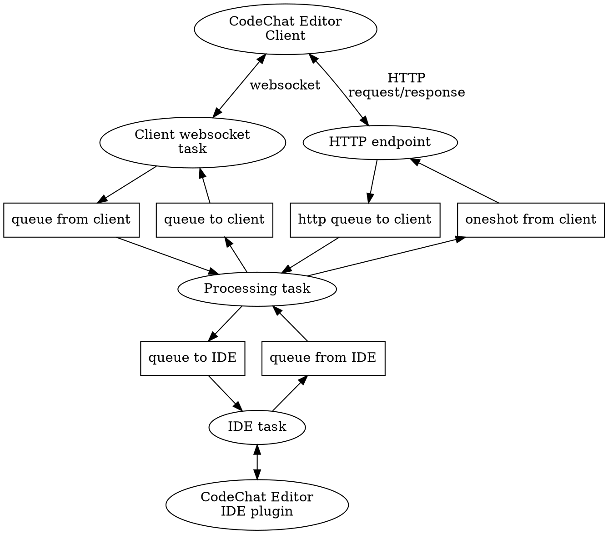

The CodeChat Editor, a word processor for software developers.<br>Copyright (C)
2024-2026 Bryan A. Jones.

This file is part of the CodeChat Editor.

The CodeChat Editor is free software: you can redistribute it and/or modify it
under the terms of the GNU General Public License as published by the Free
Software Foundation, either version 3 of the License, or (at your option) any
later version.

The CodeChat Editor is distributed in the hope that it will be useful, but
WITHOUT ANY WARRANTY; without even the implied warranty of MERCHANTABILITY or
FITNESS FOR A PARTICULAR PURPOSE. See the GNU General Public License for more
details.

You should have received a copy of the GNU General Public License along with the
CodeChat Editor. If not, see
[http://www.gnu.org/licenses](http://www.gnu.org/licenses).

<h1 id="cc-NA_6trJrnu">Translation documentation</h1>

The IDE extension client (IDE for short) and the CodeChat Editor Client (or
Editor for short) exchange messages with each other, mediated by the CodeChat
Server. The Server forwards messages from one client to the other, translating
as necessary (for example, between source code and the Editor format). This
module implements the protocol for this forwarding and translation logic; the
actuation translation algorithms are implemented in the processing module.

Overview
--------

### Architecture

It uses a set of queues to decouple websocket protocol activity from the core
processing needed to translate source code between a CodeChat Editor Client and
an IDE client. The following diagram illustrates this approach:



The queues use multiple-sender, single receiver (mpsc) types. The exception to
this pattern is the HTTP endpoint. This endpoint is invoked with each HTTP
request, rather than operating as a single, long-running task. It sends the
request to the processing task using an mpsc queue; this request includes a
one-shot channel which enables the request to return a response to this specific
request instance. The endpoint then returns the provided response.

### Protocol

The following diagrams formally define the forwarding and translation protocol
which this module implements.

* The startup phase loads the Client framework into a browser:

  ```mermaid
  sequenceDiagram
  participant IDE
  participant Server
  participant Client
  note over IDE, Client: Startup
  IDE ->> Server: Opened(IdeType)
  Server ->> IDE: Result(String: OK)
  Server ->> IDE: ClientHtml(String: HTML or URL)
  IDE ->> Server: Result(String: OK)
  note over IDE, Client: Open browser (Client framework HTML or URL)
  loop
    Client -> Server: HTTP request(/static URL)
    Server -> Client: HTTP response(/static data)
  end
  ```

* If the current file in the IDE changes (including the initial startup, when
  the change is from no file to the current file), or a link is followed in the
  Client's iframe:

  ```mermaid
  sequenceDiagram
  participant IDE
  participant Server
  participant Client
  alt IDE loads file
    IDE ->> Client: CurrentFile(String: Path of main.py)
    opt If Client document is dirty
        Client ->> IDE: Update(String: contents of main.py)
        IDE ->> Client: Response(OK)
    end
    Client ->> IDE: Response(OK)
  else Client loads file
    Client ->> IDE: CurrentFile(String: URL of main.py)
    IDE ->> Client: Response(OK)
  end
  Client ->> Server: HTTP request(URL of main.py)
  Server ->> IDE: LoadFile(String: path to main.py)
  IDE ->> Server: Response(LoadFile(String: file contents of main.py))
  alt main.py is editable
    Server ->> Client: HTTP response(contents of Client)
    Server ->> Client: Update(String: contents of main.py)
    Client ->> Server: Response(OK)
    loop
        Client ->> Server: HTTP request(URL of supporting file in main.py)
        Server ->> IDE: LoadFile(String: path of supporting file)
        alt Supporting file in IDE
            IDE ->> Server: Response(LoadFile(contents of supporting file)
            Server ->> Client: HTTP response(contents of supporting file)
        else Supporting file not in IDE
            IDE ->> Server: Response(LoadFile(None))
            Server ->> Client: HTTP response(contents of supporting file from /// filesystem)
        end
    end
  else main.py not editable and not a project
    Server ->> Client: HTTP response(contents of main.py)
  else main.py not editable and is a project
    Server ->> Client: HTTP response(contents of Client Simple Viewer)
    Client ->> Server: HTTP request (URL?raw of main.py)
    Server ->> Client: HTTP response(contents of main.py)
  end
  ```

* If the current file's contents in the IDE are edited:

  ```mermaid
  sequenceDiagram
  participant IDE
  participant Server
  participant Client
  IDE ->> Server: Update(String: new text contents)
  alt Main file is editable
    Server ->> Client: Update(String: new Client contents)
  else Main file is not editable
    Server ->> Client: Update(String: new text contents)
    note over Client: Reload the document showing the main file
    Client ->> Server: HTTP request(URL of main file)
    Server ->> IDE: LoadFile(String: path to main file)
    IDE ->> Server: Response(LoadFile(String: file contents of main file))
    Server ->> Client: HTTP response(contents of main file)
  end
  Client ->> IDE: Response(String: OK)
  ```

* If the current file's contents in the Client are edited, the Client sends the
  IDE an `Update` with the revised contents.

* If a change elsewhere in the project outdates the rendering of the current
  file or of the project's TOC, the project's cache notifies the Server, which
  re-renders it and sends any change to the Client: an `Update` for the current
  file, or an `UpdateToc` for the TOC in the Client's sidebar. The Client
  replies to each with a `Result`. Editing the TOC itself also sends an
  `UpdateToc`. See `Connections` in the [cache spec](processing/cache-spec.md).

* When the PC goes to sleep then wakes up, the IDE client and the Editor client
  both reconnect to the websocket URL containing their assigned ID.

* If the Editor client or the IDE client are closed, they close their websocket,
  which sends a `Close` message to the other websocket, causes it to also close
  and ending the session.

* If the server is stopped (or crashes), both clients shut down after several
  reconnect retries.

### Editor-overlay filesystem

When the Client displays a file provided by the IDE, that file may not exist in
the filesystem (a newly-created document), the IDE's content may be newer than
the filesystem content (an unsaved file), or the file may exist only in the
filesystem (for examples, images referenced by a file). The Client loads files
by sending HTTP requests to the Server with a URL which includes the path to the
desired file. Therefore, the Server must first ask the IDE if it has the
requested file; if so, it must deliver the IDE's file contents; if not, it must
load thee requested file from the filesystem. This process -- fetching from the
IDE if possible, then falling back to the filesystem -- defines the
editor-overlay filesystem.

#### Message IDs

The message system connects the IDE, Server, and Client; all three can serve as
the source or destination for a message. Any message sent should produce a
Response message in return. Therefore, we need globally unique IDs for each
message. To achieve this, the Server uses IDs that are multiples of 3 (0, 3, 6,
...), the Client multiples of 3 + 1 (1, 4, 7, ...) and the IDE multiples of 3 +
2 (2, 5, 8, ...). A double-precision floating point number (the standard
[numeric type](https://developer.mozilla.org/en-US/docs/Web/JavaScript/Data_structures#number_type)
in JavaScript) has a 53-bit mantissa, meaning IDs won't wrap around for a very
long time.
